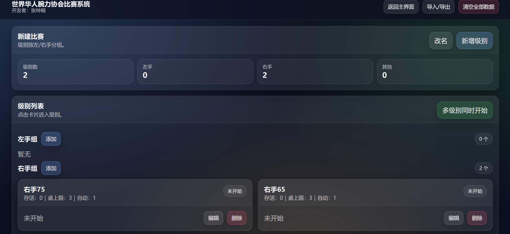
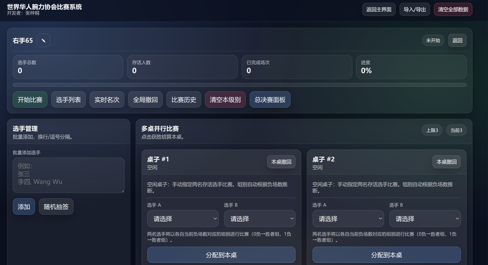
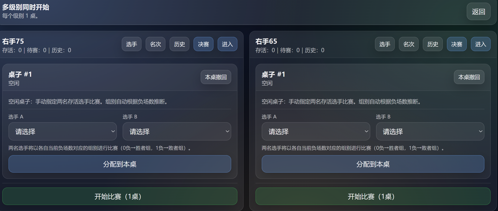

# 腕力赛事数字化全栈系统

> 🏆 获世界华人腕力协会官方认证 | 覆盖 12 场全国级赛事 | 赛事运营效率提升 60%

一个完全由 **AI Coding（Cursor + Claude Code）** 驱动开发的全栈 SaaS 产品。从发现行业痛点开始，独立完成从 0 到 1 的全流程——需求调研、系统架构设计、前后端全栈开发、云端部署、用户运营。

## 🎯 解决了什么问题

传统腕力赛事完全靠人工排赛、纸质记分、微信群通知，信息流转混乱、判罚争议频发、数据无法留存。

## 🛠️ 技术栈

| 层级 | 技术 |
|------|------|
| 前端 | Vue.js / HTML / CSS / JavaScript |
| 后端 | Python / Flask |
| 数据库 | MySQL（事务数据） + MongoDB（非结构化数据） |
| 部署 | Docker / GitHub Actions / Nginx / 腾讯云 |
| AI 工具链 | Cursor（主力 IDE）· Claude Code · GitHub Copilot |

## 📸 产品截图

### 赛事管理首页

### 赛程编排

### 裁判打分

## 💡 核心功能

- 🏅 赛事全流程线上化：选手报名 → 赛程编排 → 裁判打分 → 成绩公示
- ⚖️ 判罚一致性保障：规则引擎自动校验判罚异常并实时告警
- 🔄 多裁判协作：WebSocket 实时同步，消除串行确认延迟
- 🚀 CI/CD 自动部署：新版本上线从 2 小时压缩至 15 分钟

## 📊 项目数据

- 覆盖 **12 场**全国级腕力赛事
- 赛事运营效率提升 **60%**
- 人工统计差错率降至 **0%**
- 用户满意度 **95%**
- 累计 7 轮版本迭代优化
- 依托项目搭建北京最大同类型线下集训社群，组织活动 40+ 场

## 🧠 AI Coding 驱动

本项目 90% 以上代码在 Cursor + Claude Code 辅助下完成。已形成成熟的 AI Coding 工作流：自然语言描述需求 → AI 生成代码 → 人工审查 & 测试 → 部署上线，单次迭代周期压缩至以小时计。

---

**产品地址：** https://darkheaven1419-debug.github.io/armwrestle-system/
